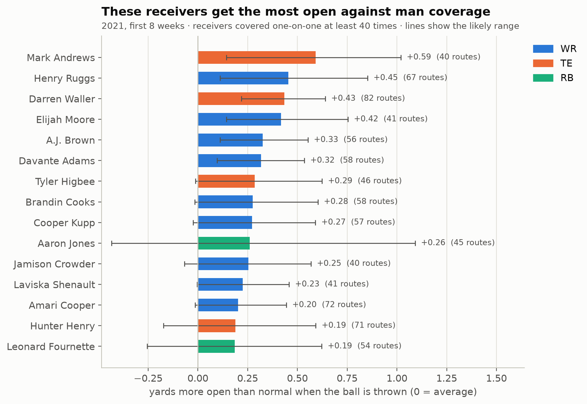
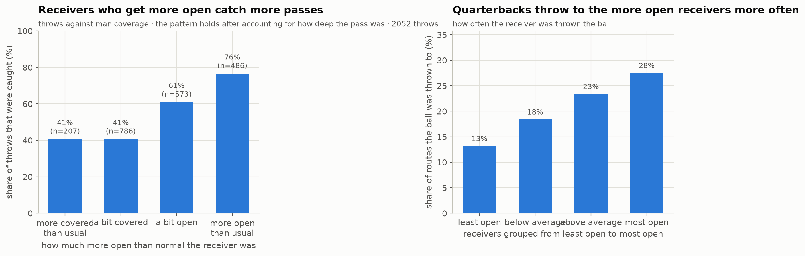
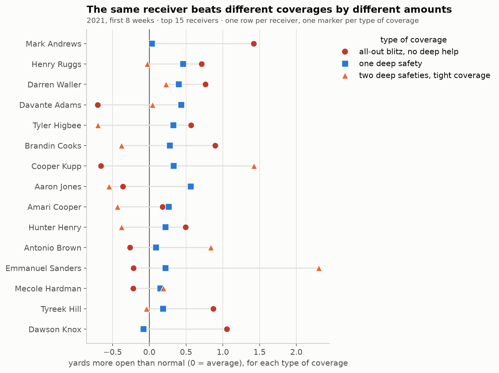
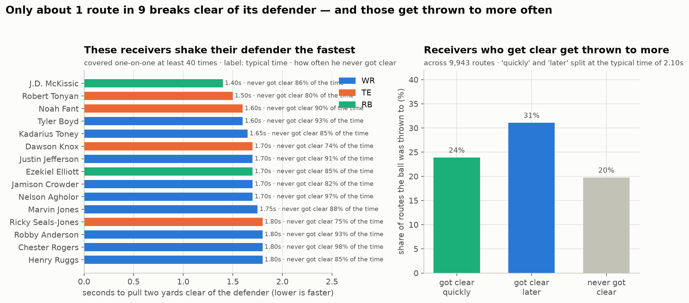
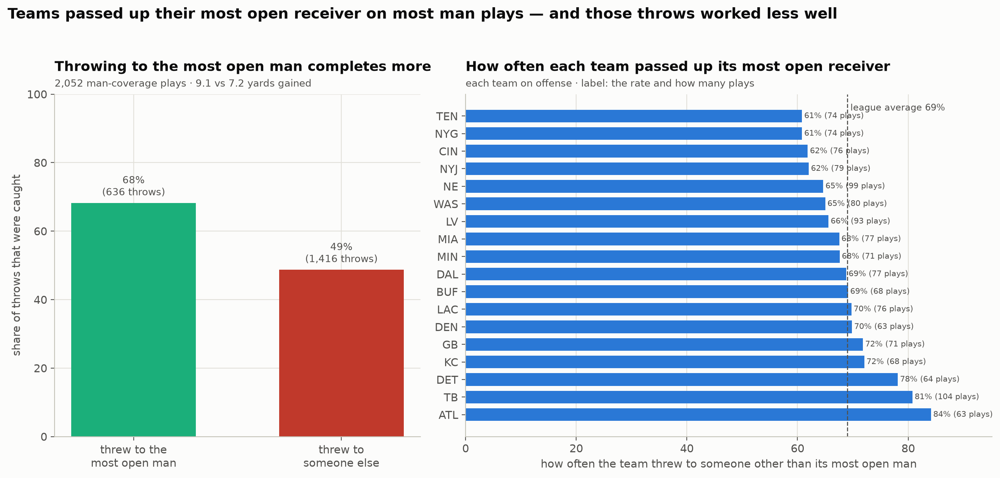
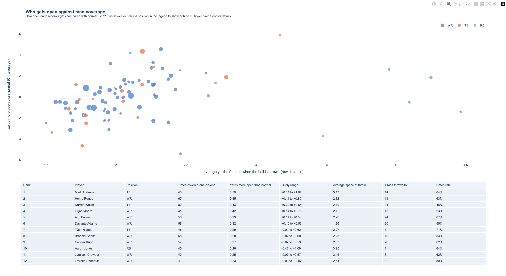

# Man-Beater Score: who actually gets open against man coverage

**Summary.** We built the Man-Beater Score, which measures how much more open a WR, TE or RB is when the ball is thrown against man coverage than is normal for that kind of play. Getting open pays off: one extra yard of space raises the chance of a catch from 52% to 63%, and quarterbacks throw to the most-open receivers twice as often (28% vs 13%). Mark Andrews, Henry Ruggs and Darren Waller rank highest, and two of the top three are tight ends. Coaches can use it to choose who to feature against man coverage, scouts to compare receivers, and broadcasters as a simple on-screen stat. It uses only the provided data; the main limits are 8 weeks of games and tracking that stops just after the throw (details below).

## In plain English
- **What we measured:** how open a receiver is when the ball is thrown, compared with how open he'd normally be on that kind of play.
- **Why it matters:** one extra yard of open space raises the chance of a catch from about 52% to 63%.
- **Who's best:** Mark Andrews, Henry Ruggs, and Darren Waller.
- **Surprise:** tight ends rank near the top, and running backs look wide open but that's just normal for the short passes they run.

A quick note on words we use. "Man coverage" is when one defender is assigned to follow one receiver all over the field. "Separation" is simply the distance in yards between the receiver and the closest defender. "Getting open" means creating enough of that distance to give the quarterback a safe place to throw.

## What is the Man-Beater Score?

When the ball is thrown, we look at how much space the receiver has from the nearest defender. Then we compare it to how much space a receiver usually gets on that same kind of play. The score is the difference. A positive score means the receiver was more open than usual. A negative score means he was more covered than usual.

This matters because beating your defender leads to catches. When a receiver has one yard more space than usual, the chance of a catch goes from about 52% to 63%. With two yards more, it climbs to 72%. Those plays also gain more yards, and quarterbacks throw to the most open receivers far more often. (These patterns are very unlikely to be luck. See the technical section for the details.)

The score is useful for a scout comparing receivers, a coach deciding who to lean on against man coverage, or a broadcaster who wants a simple number on screen.



## What we found (2021, first 8 weeks)
- **The best at getting open:** Mark Andrews (+0.59 yards more open than usual), Henry Ruggs (+0.45), Darren Waller (+0.43), Elijah Moore (+0.42), A.J. Brown (+0.33), and Davante Adams (+0.31). Two of the top three are tight ends, who are often guarded by slower defenders.
- **Raw distance can fool you.** Running backs usually have 4 or more yards of space, but their score is near zero. That space is just normal for the short routes they run. Comparing each receiver to what's normal is what makes this fair across positions.
- **Open but not thrown to:** Elijah Moore was 4th best at getting open, but caught only 3 of 13 passes thrown his way against man coverage (23%). That small number points at the passing game, not the receiver, and is worth a look on film.
- **Is it a real skill?** A receiver's score in the first four weeks and his score in the next four weeks move together, though not strongly. So it's a repeatable skill, but with real week-to-week noise.
- **Against different man looks:** no matter the exact coverage, the league as a whole averages near zero by design. On "Cover-0" (an all-out blitz with no deep help), catch rate was 54%. On "Cover-1" (one deep safety), 55%. On "2-Man", 59% (2-Man = two deep safeties, with man coverage underneath). What matters is which players beat which look, not the league average. Two of these looks are rare, so treat those splits as rough.





## Getting open: how fast?

Space at the throw is one snapshot. This part asks how quickly a receiver shakes free during the play.

Here's the catch: most receivers already stand a couple yards from the nearest defender at the snap, because of where they line up. That's spacing, not beating anyone. So we instead track the moment a receiver pulls two yards clear of the closest the defender had gotten to him.

Only about 1 in 9 routes reaches that point before the ball is thrown, and it takes about 2 seconds on average. Receivers who do break free get thrown to more often than those who never do. We want to be honest here: getting open at all draws more targets, but breaking free earlier is not clearly better than later, and the link between how fast a receiver got open and whether he was thrown to is weak. The real story is simply that getting open draws the ball.



## Being found: did the open man get the ball?

On each man-coverage play, we find the receiver who got the most open, then check whether the quarterback threw to him.

The most open receiver was not the target about 69% of the time. For context, a play usually has 3–5 receivers running routes, so even a random choice would skip the most open one most of the time. The real finding is the cost: 49% caught vs 68%. And passing him over cost something: throws to someone else were completed 49% of the time for 7.2 yards, while throws to the most open man were completed 68% of the time for 9.1 yards. How often teams looked past their most open receiver ranged from about 61% (Titans, Giants) to 84% (Falcons). Each team has only about 60 of these plays, so treat the team ranking as rough. One fair caveat: we measure "most open" at the throw, but quarterbacks decide a moment earlier, so some of these are timing and reads, not clear mistakes.



## Try it yourself
Open [`outputs/compare_tool.html`](outputs/compare_tool.html) in a browser. It plots every qualified receiver, lets you filter by position, and shows details when you hover. To compare two players directly, open [`outputs/head_to_head.html`](outputs/head_to_head.html), pick any two names, and see their cards and score ranges side by side. A single example play is saved as [`outputs/example_play.png`](outputs/example_play.png).



---

## For the technical reader

### Why this is new
- **Different side of the ball.** The 2023 Big Data Bowl used this same dataset to study pass rushers and offensive-line pass blocking. We point the tracking data at the receivers instead: who wins their route against man coverage.
- **Separation vs what's normal, not raw distance.** We don't rank receivers by how far they are from a defender. We compare their separation to what that exact route, depth, alignment and situation normally produces, so a tight end and a running back can be judged on the same scale.
- **Getting open vs being found.** We split the receiver's job from the quarterback's. *Time to Open* measures how quickly a receiver creates separation during the route (receiver skill); *Open but Ignored* measures how often the most-open receiver actually got the ball (quarterback/team decision).

### The headline numbers
- 9,943 man-coverage routes by 433 WR/TE/RB (85 with at least 40 routes).
- Completion probability at average target depth: 52% at 0 yd over expected → 63% at +1 → 72% at +2 (p = 7.8e-27, 2,052 targets — in plain terms, very unlikely to be luck).
- Yards per target rise from about 5 to about 10 as the score rises; quarterbacks target the top quartile 28% of the time vs 13% for the bottom quartile.
- Week 1–4 vs week 5–8 scores move together at Spearman ρ = 0.19 (97 players): a repeatable but noisy skill.

### Method
1. Normalize all plays to move left → right. Keep route runners (PFF `pff_role = Pass Route`, positions WR/TE/RB/FB) and coverage defenders.
2. For each route, between `ball_snap` and `pass_forward`, measure: separation from the nearest coverage defender at the snap and at the throw, route depth at the throw, and time to throw.
3. Keep man-coverage plays only (PFF `pff_passCoverageType = Man`): 9,943 routes by 433 players.
4. Predict expected separation at the throw with a gradient-boosted model, using out-of-fold predictions grouped by game so no play scores itself. Man-Beater Score = actual − expected.
5. Player score = average over his man-coverage routes (minimum 40), with a 90% bootstrap interval (a likely range for the true value).
6. Validate the score against outcomes: a model that accounts for how deep the pass was predicting completion from the score, the target rate by score quartile, yards per target by score bin, and week 1–4 vs 5–8 stability.
7. **Time to Open:** walk the tracking frames from snap to throw, track the running-minimum separation, and record the first moment separation climbs 2+ yards above that tightest point. Report per-player median time and never-open rate, and relate getting open to target and catch rate.
8. **Open but Ignored:** per man play, take the route runner with the highest Man-Beater Score and check whether he was the target; compare outcomes when he was targeted vs ignored, and summarize a missed-open rate per possession team.

### Data
Only the provided event data: tracking, plays, players, games and PFF scouting. No outside data.
**Source:** [nfl-big-data-bowl-regional-event-data](https://github.com/ThompsonJamesBliss/nfl-big-data-bowl-regional-event-data/tree/main) (NFL Next Gen Stats tracking + PFF scouting, 2021 season weeks 1–8).
- **Targeted receiver:** read from `playDescription` ("… pass short left to C.Godwin …") and matched to that play's route runners by name. It finds the target on 94% of pass attempts; checked once against public play-by-play while building it (not used by the project), it agreed on 100% of the 6,715 passes compared.
- **Pass depth:** the targeted receiver's depth downfield at the throw (tracking ends 0.5 s after the throw, so the ball's landing spot isn't available).
- **Outcome:** `passResult` (catch or not) and `prePenaltyPlayResult` (yards gained).

### Assumptions & limitations
- Separation is measured to the *nearest* coverage defender, not necessarily the assigned man; in man coverage these are usually the same.
- Tracking ends 0.5 s after the throw, so separation is measured at the release, not at the catch point.
- The target is read from the play description; the 6% of passes where no single route runner matches (e.g. throwaways) are treated as having no target.
- PFF's coverage label is for the play, so a few routes may face zone help within "man" calls.
- Samples per coverage scheme are small: Cover-0 and 2-Man have only about 150–230 targets each, so read those splits as directional, not precise.
- 8 weeks of data: player intervals are wide, and split-half stability is modest (ρ = 0.19). Rankings should be read with their intervals.
- QB quality and pass-rush pressure aren't modeled. They affect who is targeted, but not the separation measure itself.

### Run it
```bash
pip install -r requirements.txt
python run.py --data path/to/data        # folder containing tracking/, plays.csv, players.csv, games.csv, pffScoutingData.csv
```
It takes about 20 seconds and writes everything to `outputs/`.
Code: `manbeater/data.py` (loading + target from play description), `manbeater/features.py` (route features), `manbeater/score.py` (expected-separation model, score, validation, `time_to_open`, `open_but_ignored`), `manbeater/viz.py` (charts + tool), `run.py` (pipeline).

New outputs: `outputs/time_to_open.png` / `time_to_open.csv` and `outputs/open_but_ignored.png` / `open_but_ignored.csv`.
